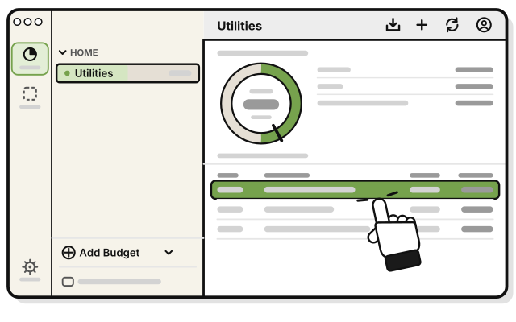
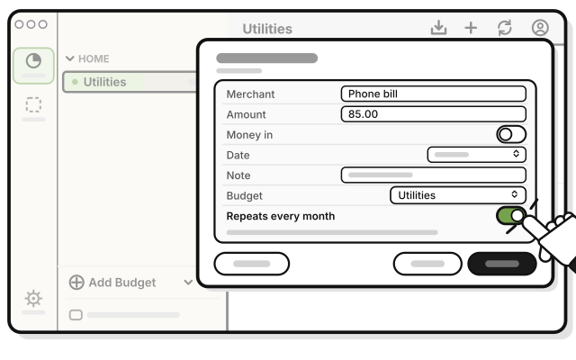
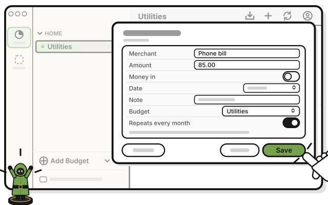
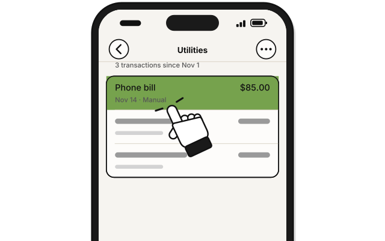
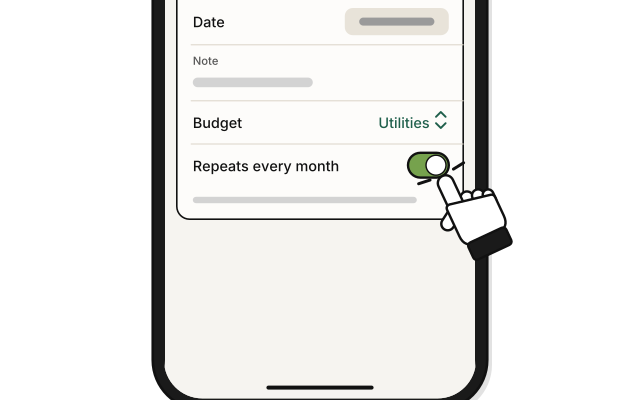
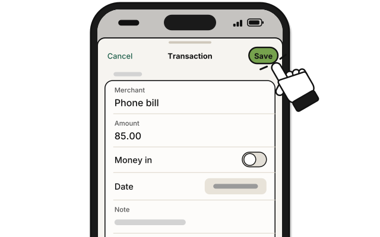
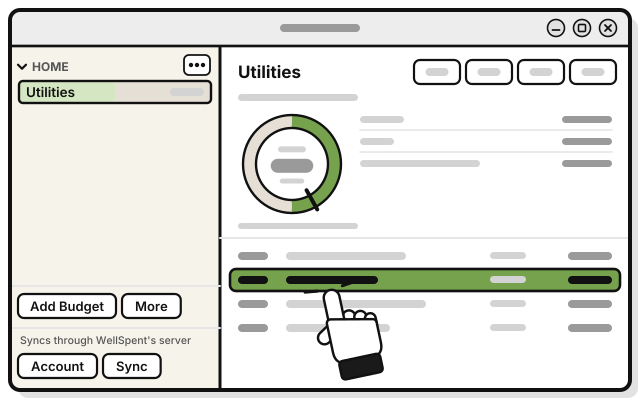
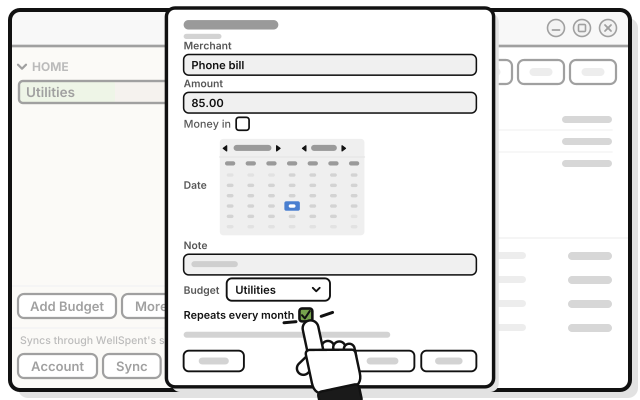
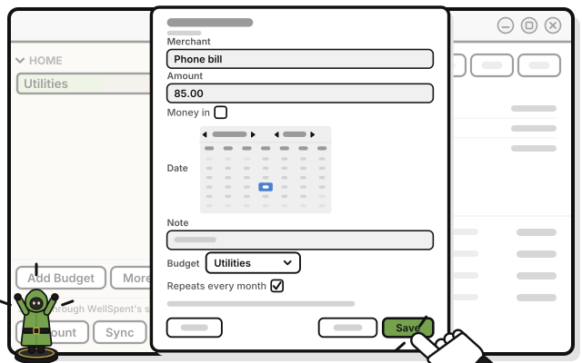

# Side quest: Make a bill repeat every month

> *Some costs come back every round. Set them up once.*

**Before you start:** you need the Add level or higher in the group. Only the person who added a bill can make it repeat.

1. 
   Click the bill in the budget's list. For a new bill, press **Add** instead.

2. 
   Turn on **Repeats every month**.

3. 
   Press **Save**.

   > You see the bill in the budget once. Under the budget's totals, the count line says **1 repeat**.

From now on, the bill shows up on the same day each month, with its **Source** reading **Repeat**.

- **A short month:** a bill set for the 31st shows up on the last day of a shorter month.
- **Time away:** if you don't open WellSpent for a while, each month you missed gets its bill when you open it again. One bill a month, never more.
- **Two devices:** your Mac and your iPhone make one bill a month between them, not two.
- **Money in** can't repeat. Its sheet has no **Repeats every month**.

## On an iPhone

**Coming in the next update.**

1. 
   In the budget, tap the bill. For a new bill, tap **Add** at the bottom instead.

2. 
   Turn on **Repeats every month**.

3. 
   Tap **Save**.

## On Linux

1. 
   Click the bill in the budget's list. For a new bill, press **Add** instead.

2. 
   Tick **Repeats every month**.

3. 
   Press **Save**.

## If it doesn't work

- **The switch is dimmed:** someone else added this bill. Only they can make it repeat.
- **There's no Repeats every month:** the bill is marked **Money in**. Money in doesn't repeat.

## Related

- [Side quest: Change a repeating bill](change-a-repeating-bill.md)
- [Side quest: Stop a repeating bill](stop-a-repeating-bill.md)
- [Side quest: Delete a repeating bill](delete-a-repeating-bill.md)

<!-- Scenarios: REPEAT-01, REPEAT-02, REPEAT-03, REPEAT-04, REPEAT-05, REPEAT-13, REPEAT-17 -->
