# Side quest: Stop a repeating bill

> *Retire a card from the deck. The ones you played stay played.*

**Before you start:** only the person who set the repeat, or someone at the Manage level, can stop it.

1. 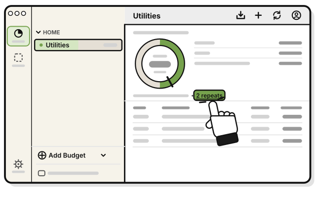
   In the budget, press the count line, such as **2 repeats**.

2. 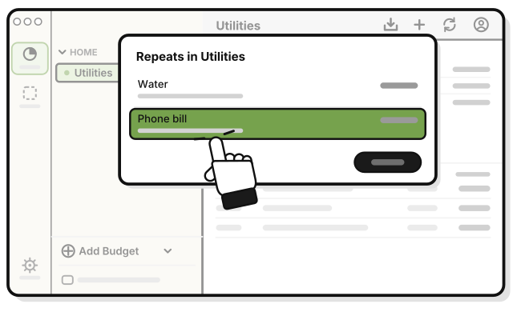
   Click the repeat.

3. 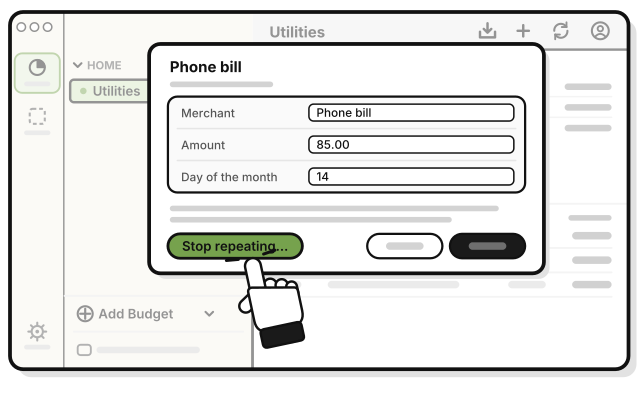
   Press **Stop repeating…**

4. 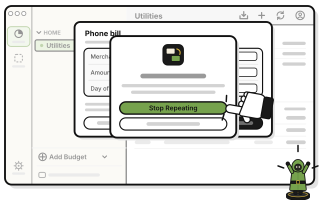
   Press **Stop Repeating** in the question.

   > You see a bar with **Undo**. The repeat leaves the list.

No more bills come. The bills already made stay, this month's too.

Changed your mind? Press **Undo** within about 10 seconds.

## Or turn it off on a bill

1. 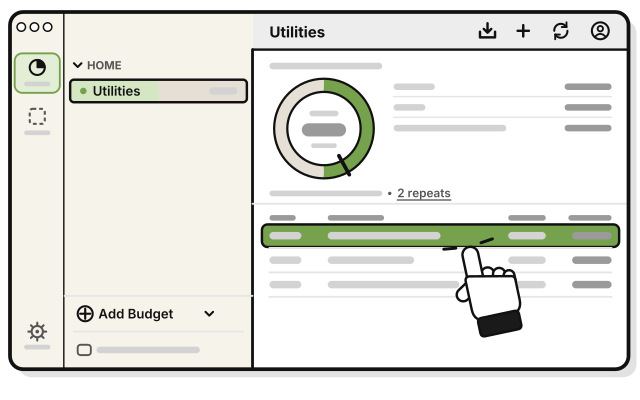
   Click any bill the repeat made.

2. 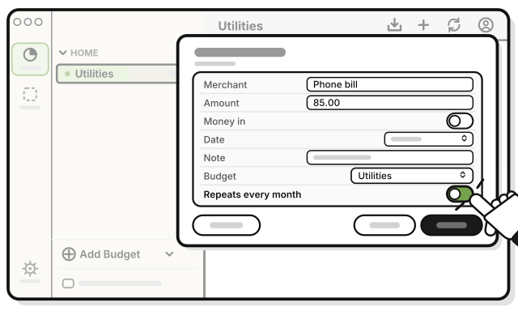
   Turn off **Repeats every month**.

   > **Which months?** and **Stop repeating…** leave the sheet.

3. 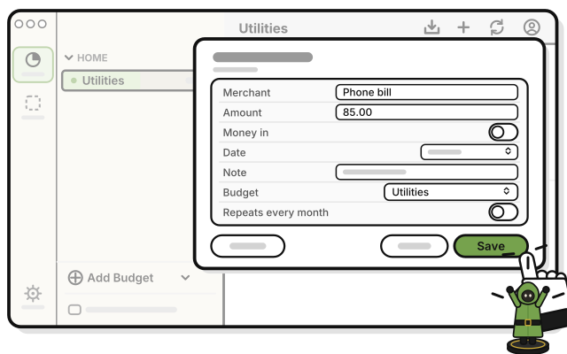
   Press **Save**.

   > You see a bar with **Undo**. Changed your mind? Press it within about 10 seconds.

Or press **Stop repeating…** on the bill's sheet. It asks "Stop repeating?" first.

To start it again, turn the switch back on and save. The repeat starts again from this month. The months it was stopped stay empty.

## On an iPhone

**Coming in the next update.**

1. 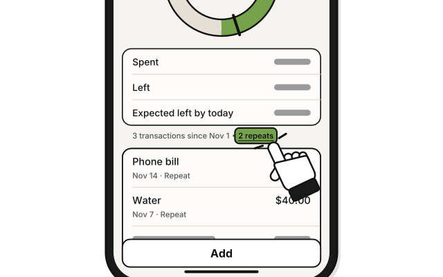
   In the budget, tap the count line, such as **2 repeats**.

2. 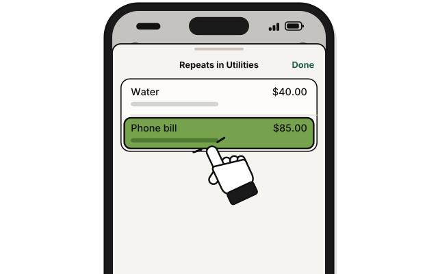
   Tap the repeat.

3. 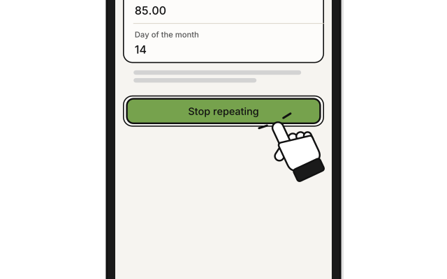
   Tap **Stop repeating…**

4. 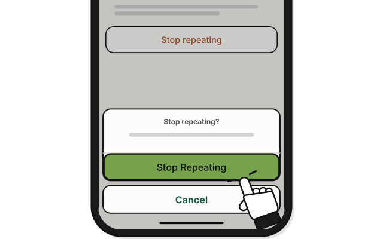
   Tap **Stop Repeating** in the question.

## On Linux

The steps are the same as on a Mac. **Repeats every month** is a check box: untick it to stop, and tick it again to start.

## Related

- [Side quest: Make a bill repeat every month](make-a-bill-repeat.md)
- [Side quest: Delete a repeating bill](delete-a-repeating-bill.md)

<!-- Scenarios: REPEAT-08, REPEAT-10, REPEAT-18 -->
