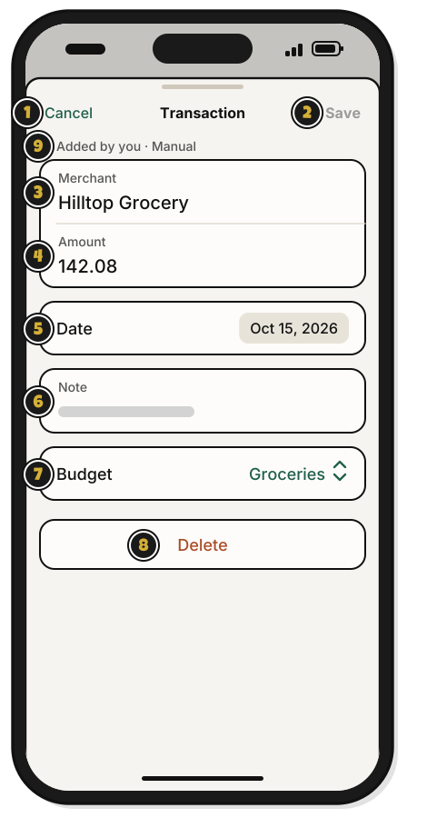
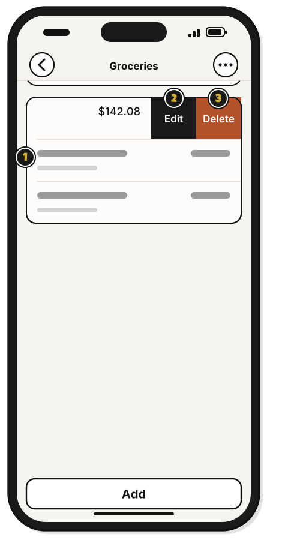

# Tour: A transaction

> *Every coin has a story. Here's where you read it.*

Click a transaction in a budget's list, and it opens like this.

1. **Merchant**: who you paid.
2. **Amount**: how much. Type it as a number.
3. **Date**: when. A date before this period keeps it off this period's page.
4. **Note**: anything to remember. It shows under the merchant.
5. **Budget**: move it to another budget in the same group.
6. **Delete…**: delete it. It asks first, and **Undo** shows for about 10 seconds after.
7. **Cancel**: close without saving.
8. **Save**: save your changes. It stays dimmed until something changes.

**Add** on a budget's page opens a shorter window, **New transaction**: **Merchant**, **Amount**, **Date** and **Note**, with **Add**.

At the View level, you can read a transaction but not change it. At Add, you can change only the ones you added.

## On an iPhone

Tap a transaction on a budget's page, and it opens like this.

1. **Cancel**: close without saving.
2. **Save**: save your changes. It stays dimmed until something changes.
3. **Merchant**: who you paid.
4. **Amount**: how much. Type it as a number.
5. **Date**: when. Tap the date to pick another day.
6. **Note**: anything to remember. It shows in the budget's list.
7. **Budget**: move it to another budget in the same group.
8. **Delete**: delete it. It asks first, and then **Undo** shows.
9. **Added by you · Manual**: how it came in, and, in a shared group, who added it.

## On an iPhone: swipe a transaction

1. A transaction: swipe it to the left, or touch and hold it.
2. **Edit**: open it, to change or move it.
3. **Delete**: delete it. It asks first.

**Add** on a budget's page opens a shorter sheet, **New transaction**: **Merchant**, **Amount**, **Date** and **Note**, with **Add**. A transaction you can't change has no swipe and no menu. It opens with its details and **Done**.

## On Linux

The window is the same as on a Mac. **Delete…** is at the bottom left, with **Cancel** and **Save** at the bottom right. For **Date**, use the arrows to reach the month, then click the day. Click each field to type in it.

<!-- Scenarios: ENTRY-02, ENTRY-03, ENTRY-04, ENTRY-06, EDIT-01, EDIT-02, EDIT-03, EDIT-04, EDIT-06, EDIT-07, EDIT-08, EDIT-10, EDIT-11 -->
