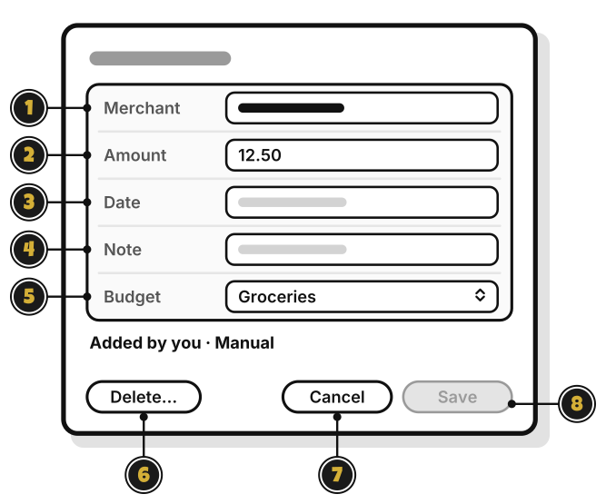

# Tour: A transaction

> *Every coin has a story. Here's where you read it.*

Click a transaction in a budget's list, and it opens like this.

1. **Merchant**: who you paid.
2. **Amount**: how much. Type it as a number.
3. **Date**: when. A date before this period keeps it off this period's page.
4. **Note**: anything to remember. It shows under the merchant.
5. **Budget**: move it to another budget in the same group.
6. **Delete…**: delete it. It asks first, and **Undo** shows for about 10 seconds after.
7. **Cancel**: close without saving.
8. **Save**: save your changes. It stays dimmed until something changes.

**Add** on a budget's page opens a shorter window, **New transaction**: **Merchant**, **Amount**, **Date** and **Note**, with **Add**.

At the View level, you can read a transaction but not change it. At Add, you can change only the ones you added.

<!-- Scenarios: ENTRY-02, ENTRY-03, ENTRY-04, ENTRY-06, EDIT-01, EDIT-02, EDIT-03, EDIT-04, EDIT-06, EDIT-07, EDIT-08, EDIT-10, EDIT-11 -->
