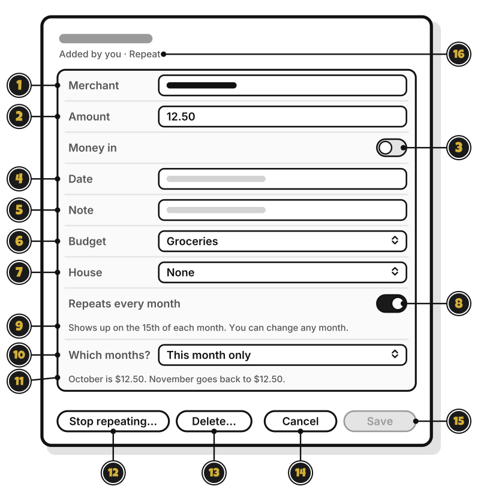
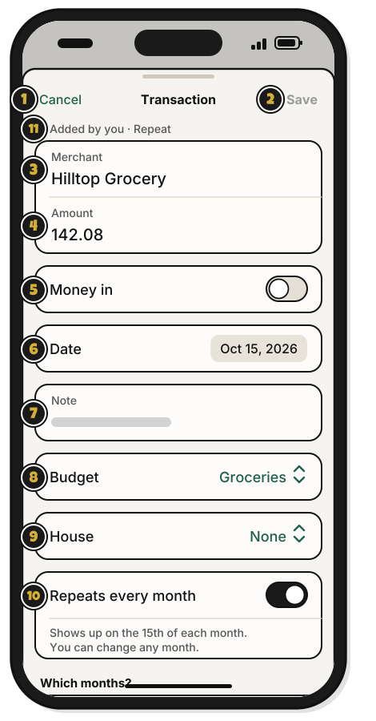
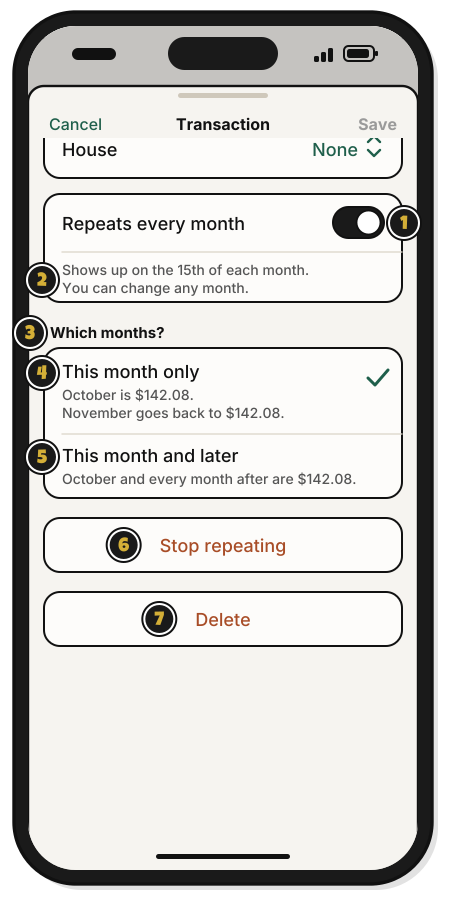
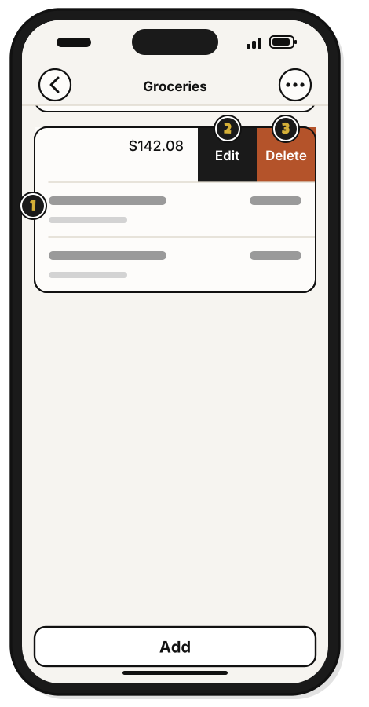
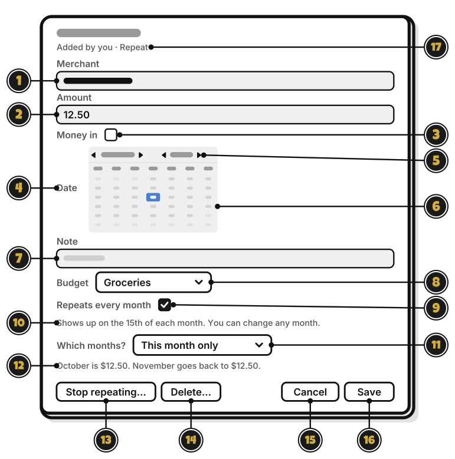

# Tour: A transaction

> *Every coin has a story. Here's where you read it.*

Click a transaction in a budget's list, and it opens like this.

1. **Merchant**: who you paid.
2. **Amount**: how much. Type it as a number.
3. **Money in**: turn it on for money coming in, not going out. [Side quest: Add money coming in](add-money-in.md)
4. **Date**: when. A date before this period keeps it off this period's page. A date later this month waits on the **Coming by** line until then.
5. **Note**: anything to remember. It shows under the merchant.
6. **Budget**: move it to another budget in the same group.
7. **House**: the house this bill is for. It shows only with Properties turned on. [Side quest: Mark a bill with a house](../houses/mark-a-bill-with-a-house.md)
8. **Repeats every month**, on: a bill that comes back each month. [Side quest: Make a bill repeat every month](make-a-bill-repeat.md)
9. The line under it: the day it shows up each month.
10. **Which months?**: what a change to this bill reaches, **This month only** or **This month and later**. [Side quest: Change a repeating bill](change-a-repeating-bill.md)
11. The line under it: what that choice does.
12. **Stop repeating…**: no more bills come. Earlier bills stay. It asks first. [Side quest: Stop a repeating bill](stop-a-repeating-bill.md)
13. **Delete…**: delete it. It asks first, and **Undo** shows for about 10 seconds after.
14. **Cancel**: close without saving.
15. **Save**: save your changes. It stays dimmed until something changes.
16. **Added by you · Repeat**: who added it, and how it came in. **Repeat** means a repeat made it.

**Add** on a budget's page opens a **New transaction** window with the same fields, and **Add** in place of **Save**.

At the View level, you can read a transaction but not change it. At Add, you can change only the ones you added.

## On an iPhone

Tap a transaction on a budget's page, and it opens like this.

1. **Cancel**: close without saving.
2. **Save**: save your changes. It stays dimmed until something changes.
3. **Merchant**: who you paid.
4. **Amount**: how much. Type it as a number.
5. **Money in**: turn it on for money coming in, not going out. [Side quest: Add money coming in](add-money-in.md)
6. **Date**: when. Tap the date to pick another day. A date later this month waits on the **Coming by** line until then.
7. **Note**: anything to remember. It shows in the budget's list.
8. **Budget**: move it to another budget in the same group.
9. **House**: the house this bill is for. It shows only with Properties turned on. [Side quest: Mark a bill with a house](../houses/mark-a-bill-with-a-house.md)
10. **Repeats every month**: make it a bill that comes back each month. [Side quest: Make a bill repeat every month](make-a-bill-repeat.md)
11. **Added by you · Repeat**: how it came in, and, in a shared group, who added it. **Repeat** means a repeat made it.

## On an iPhone: a repeating bill

Scroll down on a bill that repeats.

1. The switch, on: this bill repeats every month.
2. The line under it: the day it shows up each month.
3. **Which months?**: what a change to this bill reaches.
4. **This month only**: change this month's bill alone. The line under it says what next month goes back to.
5. **This month and later**: change this month and every month after. [Side quest: Change a repeating bill](change-a-repeating-bill.md)
6. **Stop repeating**: no more bills come. Earlier bills stay. [Side quest: Stop a repeating bill](stop-a-repeating-bill.md)
7. **Delete**: delete this bill. It asks first, and then **Undo** shows. [Side quest: Delete a repeating bill](delete-a-repeating-bill.md)

## On an iPhone: swipe a transaction

1. A transaction: swipe it to the left, or touch and hold it.
2. **Edit**: open it, to change or move it.
3. **Delete**: delete it. It asks first.

**Add** on a budget's page opens a **New transaction** sheet with the same fields, and **Add** in place of **Save**. A transaction you can't change has no swipe and no menu. It opens with its details and **Done**.

## On Linux

Click a transaction in a budget's list, and it opens like this. Click each field to type in it.

1. **Merchant**: who you paid.
2. **Amount**: how much. Type it as a number.
3. **Money in**: a check box. Tick it for money coming in, not going out. [Side quest: Add money coming in](add-money-in.md)
4. **Date**: when. A date later this month waits on the **Coming by** line until then.
5. The arrows: move the calendar a month, or a year, at a time.
6. The chosen day: click a day to set the date. The arrows alone don't change it.
7. **Note**: anything to remember. It shows under the merchant.
8. **Budget**: move it to another budget in the same group.
9. **Repeats every month**: a check box. Ticked, it's a bill that comes back each month. [Side quest: Make a bill repeat every month](make-a-bill-repeat.md)
10. The line under it: the day it shows up each month.
11. **Which months?**: what a change to this bill reaches: this month only, or this month and later. [Side quest: Change a repeating bill](change-a-repeating-bill.md)
12. The line under it: what each choice does.
13. **Stop repeating…**: no more bills come. Earlier bills stay. [Side quest: Stop a repeating bill](stop-a-repeating-bill.md)
14. **Delete…**: delete it. It asks first, and **Undo** shows for about 10 seconds after.
15. **Cancel**: close without saving.
16. **Save**: save your changes. It stays dimmed until something changes.
17. **Added by you · Repeat**: how it came in, and, in a shared group, who added it.
18. The line under **Money in**: which budget it adds to, such as "Adds to Bookings instead of spending from it." It shows only while **Money in** is ticked.

Linux has no **House** row yet.

**Add** on a budget's page opens a **New transaction** window with the same fields, and **Add** in place of **Save**.

<!-- Scenarios: INC-01, REPEAT-01, REPEAT-05, REPEAT-08, WHEEL-21, PROP-26, ENTRY-02, ENTRY-03, ENTRY-04, ENTRY-06, EDIT-01, EDIT-02, EDIT-03, EDIT-04, EDIT-06, EDIT-07, EDIT-08, EDIT-10, EDIT-11, INC-04 -->
